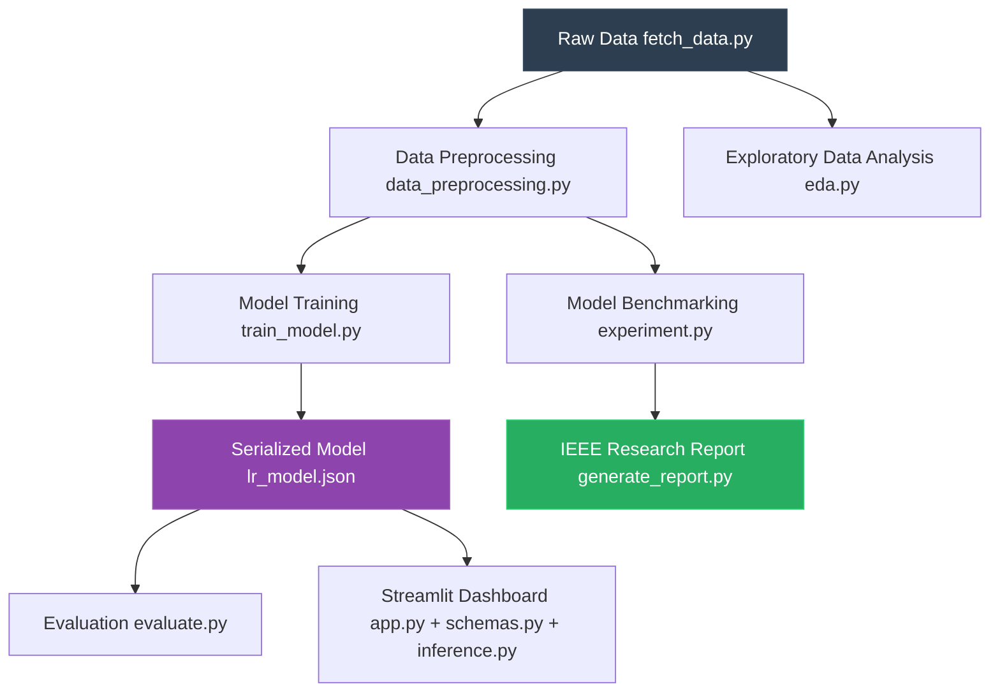

# 📉 Customer Churn Prediction (Classification)


A baseline Random Forest catches **47.3% of churning customers**. A balanced Logistic Regression catches **79.1%**. This repo ships the pipeline that proves it — data fetch, leak-free preprocessing, three-model comparison with 5-fold stratified CV and calibration analysis, Pydantic-validated Streamlit inference, and an **IEEE-formatted PDF research paper**.

## Problem Statement
Which customers are most likely to cancel their subscription, and what factors drive churn?

## Dataset
- **Source:** [Telco Customer Churn (Kaggle)](https://www.kaggle.com/datasets/blastchar/telco-customer-churn)
- **Size:** 7,043 customers × 21 columns (7,032 usable rows after dropping 11 blank `TotalCharges` records; 26.6% churn rate; 5,625 training / 1,407 held-out test rows)
- **Description:** Binary target (`Churn`: Yes/No). Contains customer demographics, account information, and service usage metrics. The script `src/fetch_data.py` pulls it automatically over HTTPS.

## Approach
1. **Data Cleaning & EDA** — Cleans nulls, generates distribution, tenure, charges, and contract plots.
2. **Feature Engineering** — Encodes categorical variables, splits the data 80/20 before fitting `StandardScaler` on training features only, and aligns single-row inference without `drop_first` baseline drift.
3. **Modeling & Validation** — Benchmarks Random Forest, class-weighted Logistic Regression, early-stopped MLP Neural Network, and XGBoost (`src/experiment.py`), validated with 5-fold stratified CV on the training split.
4. **Evaluation & Guardrails** — Evaluates Precision, Recall, F1-Score, ROC-AUC, PR-AUC, Brier calibration, and retention campaign ROI; validates Streamlit inputs against `CustomerProfile` (Pydantic v2); loads runtime weights from JSON without pickle (`models/lr_model.json`); and renders an IEEE-format PDF report.

## Key Results
| Model | Accuracy | Churn Precision | Churn Recall | Churn F1 | ROC-AUC | PR-AUC | Brier |
|--------|-------|-------|-------|-------|-------|-------|-------|
| Random Forest (Baseline) | 78.5% | 0.63 | 47.3% | 0.54 | 0.815 | 0.605 | 0.148 |
| Logistic Regression (Balanced) | 73.1% | 0.50 | 79.1% | 0.61 | 0.832 | 0.628 | 0.173 |
| Deep Learning (MLP) | 78.0% | 0.63 | 43.3% | 0.51 | 0.829 | 0.637 | 0.143 |

## Key Findings
1. A baseline Random Forest looks strong on overall accuracy (78.5%) but misses over half the customers about to churn (47.3% recall, 197 false negatives).
2. Balanced Logistic Regression trades 5.3 points of overall accuracy to catch **31.8 percentage points more churners** (79.1% recall, 296 vs. 177 true positives), with 5-fold CV confirming `0.847 ± 0.013` ROC-AUC and `0.800 ± 0.032` recall.
3. **Business & Calibration Implication:** Under retention economics of $780 saved LTV and $50 outreach cost per flagged account across 1,407 evaluated customers, Balanced Logistic Regression yields +$12,196 (30% save rate) to +$30,760 (50% save rate) in incremental net profit over the baseline. Post-hoc probability calibration (Platt or isotonic) is recommended before using raw class-weighted probabilities for expected-value spend optimization.

## How to Run

### Option 1: Local Setup

```bash
pip install -r requirements.txt
python src/fetch_data.py           # pulls Telco dataset -> data/
python src/eda.py                  # EDA plots -> plots/
python src/train_model.py          # trains model -> models/
python src/evaluate.py             # classification report + confusion matrix
python src/generate_report.py      # 3-model comparison -> churn_prediction_report.pdf (IEEE format)
streamlit run app.py               # runs the interactive dashboard
```

### Option 2: Docker

```bash
docker build -t churn-prediction .
docker run -p 8501:8501 churn-prediction
# Open http://localhost:8501 in your browser
```

## Testing

```bash
pytest --cov=src --cov=app --cov-report=term-missing -v
```

**61 tests** covering input schema validation, leak-free preprocessing, inference column alignment, JSON model serialization equivalence, model training, evaluation end-to-end execution, EDA, HTTPS data fetching, Streamlit app import/execution safety, and IEEE report helpers (PR curves, signed LR coefficients, retention ROI math, page callbacks). CI enforces a 40% minimum coverage gate.

| Module | Coverage |
|--------|----------|
| `src/inference.py` | 100% |
| `src/schemas.py` | 100% |
| `src/eda.py` | 97% |
| `src/evaluate.py` | 97% |
| `src/train_model.py` | 96% |
| `src/fetch_data.py` | 92% |
| `app.py` | 82% |
| `src/data_preprocessing.py` | 80% |
| `src/generate_report.py` | 47% |
| `src/experiment.py` | 0% |
| **Total** | **66%** |

## Files
- `app.py` — Streamlit prediction dashboard with Pydantic validation and HTML-escaped output
- `src/schemas.py` — Pydantic v2 `CustomerProfile` input validation schema (`extra="forbid"`, finite bounds)
- `src/inference.py` — Pure preprocessing, single-row alignment, and zero-pickle JSON model helpers
- `src/fetch_data.py` — Downloads Telco Customer Churn CSV over HTTPS with timeout and redirect checks
- `src/data_preprocessing.py` — Cleans data, splits 80/20, and scales training features without leakage
- `src/eda.py` — Generates distribution and demographic plots
- `src/train_model.py` — Trains balanced `LogisticRegression`, saves `models/lr_model.json` and `models/rf_model.pkl`
- `src/evaluate.py` — Evaluates test set from `models/lr_model.json` and saves confusion matrix
- `src/experiment.py` — Benchmarks 6 model variants
- `src/generate_report.py` — Trains RF + LR + early-stopped MLP, runs 5-fold CV + ROI economics, and renders an IEEE two-column PDF
- `churn_prediction_report.pdf` — Auto-generated IEEE research paper
- `GUARDRAILS.md` — Runtime, ML pipeline, and security guardrails specification
- `tests/` — 61 unit and regression tests with coverage tracking

## Methodology & Limitations
The pipeline separates data ingestion, preprocessing, inference alignment, training, and evaluation into distinct modules for reproducibility. Automated tests via `pytest` (61 tests, 66% coverage) and security scans (`bandit` and `pip-audit`) run in GitHub Actions CI.

One limitation is that the models assume historical patterns predict future churn without accounting for external macroeconomic shifts or uncaptured retention campaigns. Additionally, the Deep Learning (MLP) model used a constrained 5-iteration search without explicit class weighting; broader tuning with focal loss or threshold optimization could improve its recall relative to balanced Logistic Regression.

---

### Pipeline Architecture


